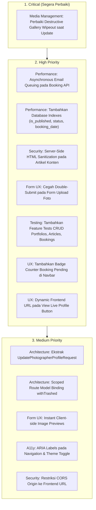

# Comprehensive 7-Area Dashboard & Backend Audit
**Target Project:** `dashboard-jef` (Laravel 12 + Blade + Tailwind CSS + Alpine.js)  
**Date:** 15 November 2026  
**Status:** Complete Audit & Architecture Review

---

## Executive Summary

Audit ini mengevaluasi arsitektur backend dan dashboard admin fotografer profesional Jef (`dashboard-jef`). Backend dibangun di atas Laravel 12 dengan arsitektur Blade + Alpine.js + Tailwind CSS, serta melayani RESTful API publik untuk front-end Nuxt 3 (`portfolio-jeff`).

Secara keseluruhan, backend berada dalam kondisi fungsional yang stabil (38/38 automated tests lulus), memiliki implementasi SoftDeletes & Trash yang baik, pemisahan Service layer pada konten utama, dan proteksi otentikasi Breeze yang rapi. Namun, audit menemukan beberapa isu arsitektural dan UX kritis, terutama:
1. **Destructive Gallery Replacement:** Pengunggahan gambar galeri baru menghapus seluruh koleksi foto lama secara permanen (all-or-nothing).
2. **Synchronous Email Dispatch:** Pengiriman email notifikasi booking dijalankan sinkron di thread HTTP, berisiko timeout pada front-end.
3. **Absennya Indeks Database:** Kolom pencarian & filter API utama (`is_published`, `is_highlight`, `status`) belum memiliki index.
4. **Absennya Authorization Policies & Role Gate:** Seluruh user yang terautentikasi memiliki akses penuh superadmin tanpa batasan Policy.
5. **Ketiadaan Test CRUD Utama:** Belum ada dedicated feature test untuk admin Portfolios, Articles, dan Bookings CRUD.

---

## 1. Dashboard UX

### 1.1 Metrik Ringkasan Terbatas & Kurang Komprehensif
- **Kondisi:** [DashboardController.php](file:///d:/Freelance/dashboard-jef/app/Http/Controllers/Admin/DashboardController.php#L14-L28) hanya menghitung status booking (`pending`, `confirmed`, `completed`) dan `publishedPortfoliosCount`. Metrik seperti total artikel/esai, total karya foto, utilisasi storage, atau ringkasan aktivitas terbaru belum tersedia.
- **Dampak UX:** Fotografer tidak mendapatkan gambaran utuh performa konten dan kapasitas sistem.
- **Rekomendasi:** Tambahkan card metrik untuk Articles, Total Photos in Gallery, dan recent activity stream.
- **Prioritas:** Medium

### 1.2 Ketiadaan Badge Notifikasi Booking di Navbar
- **Kondisi:** Di [navigation.blade.php](file:///d:/Freelance/dashboard-jef/resources/views/layouts/navigation.blade.php#L34-L38), menu `Booking` tidak menampilkan counter/badge jumlah booking pending (`{{ $pendingBookingsCount }}`).
- **Dampak UX:** Admin harus membuka halaman Dashboard atau mengklik menu Booking terlebih dahulu untuk mengetahui apakah ada klien baru yang mengirimkan permintaan sesi foto.
- **Rekomendasi:** Tambahkan badge counter berwarna kuning/merah kecil di samping teks menu `Booking` apabila ada pending request.
- **Prioritas:** High

### 1.3 Inkonsistensi Palet Warna Admin vs Identitas Brand
- **Kondisi:** Dashboard menggunakan tema warna emerald green yang dominan (`bg-green-600`, gradient `from-green-50 to-green-100`, border hijau), sementara identitas visual fotografi Jef mengusung minimalisme monokromatik Jepang (`#FAF9F6` canvas dan `#18181B` charcoal ink).
- **Dampak UX:** Pengalaman visual terasa terputus antara studio brand dan sistem internalnya (terkesan seperti aplikasi akuntansi/fintech daripada studio fotografi seni).
- **Rekomendasi:** Harmonisasi aksen dashboard menjadi palet netral/charcoal dengan aksen zinc/stone yang elegan, tetap mempertahankan warna status fungsional (kuning untuk pending, biru untuk confirmed, hijau untuk completed).
- **Prioritas:** Low

### 1.4 Hardcoded Environment URL
- **Kondisi:** Pada [edit.blade.php](file:///d:/Freelance/dashboard-jef/resources/views/admin/photographer_profile/edit.blade.php#L15), tautan pratinjau profil publik di-hardcode ke `http://localhost:3000/about`.
- **Dampak:** Di lingkungan produksi (*production*), tombol ini akan rusak dan mengarahkan admin ke localhost komputernya sendiri.
- **Rekomendasi:** Gunakan konfigurasi dinamis `config('app.frontend_url', 'http://localhost:3000') . '/about'`.
- **Prioritas:** High

---

## 2. CRUD & Data Architecture

### 2.1 Inconsistent Route Model Binding
- **Kondisi:**
  - Route CRUD standar di [web.php](file:///d:/Freelance/dashboard-jef/routes/web.php#L25) menggunakan route model binding implisit: `show(Portfolio $portfolio)`, `edit(Portfolio $portfolio)`.
  - Namun pada aksi `restore` dan `forceDestroy` di [PortfolioController.php](file:///d:/Freelance/dashboard-jef/app/Http/Controllers/Admin/PortfolioController.php#L104-L115), method menerima parameter mentah `$id` dan memanggil manual `Portfolio::withTrashed()->findOrFail($id)`.
- **Dampak:** Kode menjadi kurang konsisten dan tidak memanfaatkan kapabilitas scoped route model binding modern Laravel (`->withTrashed()`).
- **Rekomendasi:** Gunakan `Route::post('/portfolios/{portfolio}/restore', ...)->withTrashed();` dan type-hint `(Portfolio $portfolio)` di controller.
- **Prioritas:** Medium

### 2.2 Struktur Data Gallery Tidak Ternormalisasi (Raw JSON Array)
- **Kondisi:** File galeri disimpan dalam kolom tunggal berformat JSON `gallery` pada tabel `portfolios` ([create_portfolios_table.php](file:///d:/Freelance/dashboard-jef/database/migrations/2026_02_07_152947_create_portfolios_table.php#L21)).
- **Dampak:**
  - Tidak ada ID unik per foto dalam galeri.
  - Tidak dapat melakukan penghapusan atau penyortiran urutan (*reordering*) per foto secara independen tanpa memanipulasi keseluruhan array JSON.
- **Rekomendasi:** Untuk jangka pendek, sediakan endpoint API/controller untuk menghapus item array foto spesifik berdasarkan index/hash. Untuk jangka panjang, pertimbangkan migrasi ke tabel terelasi `portfolio_images (id, portfolio_id, image_path, sort_order)`.
- **Prioritas:** High

### 2.3 Status Toggle Logic yang Solid
- **Kondisi:** Method `toggle()` pada [PortfolioController.php](file:///d:/Freelance/dashboard-jef/app/Http/Controllers/Admin/PortfolioController.php#L41-L81) dan [ArticleController.php](file:///d:/Freelance/dashboard-jef/app/Http/Controllers/Admin/ArticleController.php#L86-L112) mengimplementasikan aturan bisnis yang cerdas:
  - Mengaktifkan highlight otomatis menerbitkan karya (`is_published = true`) dan mencatat `published_at = now()`.
  - Menonaktifkan status terbit otomatis mencabut highlight (`is_highlight = false`).
- **Penilaian:** Implementasi ini sangat baik, melindungi integritas relasi data di API publik.
- **Prioritas:** Good Practice (Pertahankan)

---

## 3. Media Management

### 3.1 Destructive Gallery Replacement (Isu Kritis)
- **Kondisi:** Di [PortfolioService.php](file:///d:/Freelance/dashboard-jef/app/Services/PortfolioService.php#L74-L90):
  ```php
  if ($request->hasFile('gallery')) {
      if (!empty($portfolio->gallery)) {
          foreach ($portfolio->gallery as $oldImage) {
              if (! Str::startsWith($oldImage, ['http://', 'https://'])) {
                  Storage::delete($oldImage);
              }
          }
      }
      $galleryPaths = [];
      foreach ($request->file('gallery') as $image) {
          $galleryPaths[] = $image->store('portfolios/galleries');
      }
      $data['gallery'] = $galleryPaths;
  }
  ```
- **Dampak:** Apabila sebuah karya portofolio sudah memiliki 12 foto, dan admin hanya ingin menambahkan 1 foto baru atau memperbaiki 1 foto, sistem akan **menghapus ke-12 foto lama dari disk** dan hanya menyisakan foto yang baru diunggah!
- **Rekomendasi:** Sediakan mode *append* (tambahkan ke array yang sudah ada) atau sediakan tombol hapus per thumbnail galeri dengan AJAX/Livewire/form terpisah.
- **Prioritas:** Critical

### 3.2 Inkonsistensi Spesifikasi Storage Disk
- **Kondisi:**
  - [PhotographerProfileController.php](file:///d:/Freelance/dashboard-jef/app/Http/Controllers/Admin/PhotographerProfileController.php#L46-L61) secara eksplisit mendefinisikan `$disk = config('filesystems.default', 'public');` dan memanggil `Storage::disk($disk)`.
  - [PortfolioService.php](file:///d:/Freelance/dashboard-jef/app/Services/PortfolioService.php#L30) dan [ArticleService.php](file:///d:/Freelance/dashboard-jef/app/Services/ArticleService.php#L30) memanggil `$file->store('...')` dan `Storage::delete(...)` tanpa parameter disk eksplisit (bergantung pada default disk global).
- **Dampak:** Saat beralih ke disk cloud (`r2` atau `s3`), bila konfigurasi `FILESYSTEM_DISK` tidak terdefinisi sempurna, file profil tersimpan di satu disk sementara portfolio tersimpan di disk lain.
- **Rekomendasi:** Standarisasi pemanggilan storage dengan helper atau service yang secara konsisten menggunakan disk yang sama.
- **Prioritas:** High

### 3.3 Kesiapan Integrasi Cloudflare R2
- **Kondisi:**
  - Konfigurasi disk `'r2'` sudah ada di [config/filesystems.php](file:///d:/Freelance/dashboard-jef/config/filesystems.php#L63-L70).
  - Namun di [PortfolioResource.php](file:///d:/Freelance/dashboard-jef/app/Http/Resources/PortfolioResource.php#L22) dan [ArticleResource.php](file:///d:/Freelance/dashboard-jef/app/Http/Resources/ArticleResource.php#L22):
    ```php
    return url(Storage::url($path));
    ```
- **Dampak:** Jika Cloudflare R2 dikonfigurasi dengan custom domain CDN (`https://media.jeflee.photography`), `Storage::disk('r2')->url($path)` sudah mengembalikan URL absolut HTTPS. Membungkusnya kembali dengan fungsi `url(...)` berisiko menghasilkan URL malformed jika regex URL tidak cocok secara presisi.
- **Rekomendasi:** Gunakan pemeriksaan eksplisit: `Str::startsWith($url, ['http://', 'https://']) ? $url : url($url);`.
- **Prioritas:** High

---

## 4. Form UX

### 4.1 Ketiadaan Client-Side Instant Image Preview
- **Kondisi:** Pada [portfolios/form.blade.php](file:///d:/Freelance/dashboard-jef/resources/views/admin/portfolios/form.blade.php#L66-L95), [articles/form.blade.php](file:///d:/Freelance/dashboard-jef/resources/views/admin/articles/form.blade.php#L26), dan form avatar profil:
  - Form hanya menampilkan preview gambar lama (*current image*).
  - Saat admin memilih file baru dari komputer, tidak ada pratinjau instan (*live preview*) sebelum form dikirim.
- **Dampak UX:** Fotografer tidak dapat memverifikasi apakah file foto yang dipilih sudah benar sebelum menekan tombol simpan dan menunggu proses upload selesai.
- **Rekomendasi:** Tambahkan Alpine.js reactive preview (`URL.createObjectURL(event.target.files[0])`) pada input file gambar.
- **Prioritas:** Medium

### 4.2 Tombol Submit Rentan Double Submission
- **Kondisi:** Tombol submit pada seluruh form create/edit (`admin/portfolios`, `admin/articles`, `admin/photographer_profile`) tidak memiliki status `loading` atau atribut `disabled` saat proses submit berlangsung.
- **Dampak:** Ketika mengunggah file foto resolusi tinggi (misal total 15MB), koneksi internet membutuhkan waktu beberapa detik. Jika pengguna mengklik tombol submit berkali-kali, server akan menerima multiple request yang dapat menyebabkan duplikasi data atau error race condition.
- **Rekomendasi:** Tambahkan Alpine.js submit state: `@submit="submitting = true"` dan `:disabled="submitting"`, serta tampilkan spinner animasi.
- **Prioritas:** High

### 4.3 Inkonsistensi Bahasa Antarmuka Form
- **Kondisi:**
  - Header alert error di [articles/create.blade.php](file:///d:/Freelance/dashboard-jef/resources/views/admin/articles/create.blade.php#L16) berbahasa Indonesia: `"Oops! Ada yang salah:"`.
  - Pesan validasi di [StorePortfolioRequest.php](file:///d:/Freelance/dashboard-jef/app/Http/Requests/StorePortfolioRequest.php#L31) berbahasa Indonesia: `'title.required' => 'Title wajib diisi'`.
  - Sementara seluruh label form, tombol aksi, dan pesan sistem lainnya berbahasa Inggris ("Create New Article", "Save Article", "Portfolio successfully created!").
- **Dampak:** Kesan profesional berkurang akibat percampuran bahasa tanpa lokalisasi terstruktur.
- **Rekomendasi:** Standarisasi seluruh teks pesan validasi dan alert dashboard ke dalam bahasa Inggris yang konsisten.
- **Prioritas:** Low

### 4.4 Form Request Tidak Digunakan pada Photographer Profile
- **Kondisi:** [PhotographerProfileController.php](file:///d:/Freelance/dashboard-jef/app/Http/Controllers/Admin/PhotographerProfileController.php#L21-L43) mengeksekusi validasi inline `$request->validate([...])` dengan lebih dari 20 aturan validasi langsung di dalam controller.
- **Dampak:** Melanggar prinsip *Single Responsibility* dan standar arsitektur Laravel (Rule 34 `laravel.csv`).
- **Rekomendasi:** Ekstrak ke dalam class `App\Http\Requests\UpdatePhotographerProfileRequest`.
- **Prioritas:** Medium

---

## 5. Backend Security

### 5.1 Ketiadaan Authorization Policies & Role Checking
- **Kondisi:**
  - Seluruh route admin diproteksi oleh middleware `auth` biasa di [web.php](file:///d:/Freelance/dashboard-jef/routes/web.php#L18).
  - Direktori `app/Policies` tidak ada.
  - Model `User` tidak memiliki kolom `role` atau `is_admin`.
- **Dampak Keamanan:** Meskipun saat ini registrasi publik dinonaktifkan, setiap user yang berhasil dibuat di tabel `users` otomatis memiliki hak istimewa superadmin tanpa batas (bisa mengedit karya, mengubah profil fotografer, membaca data booking pribadi klien, dan menghapus permanen data).
- **Rekomendasi:** Buat Policy atau middleware otorisasi sederhana untuk memastikan hanya user dengan identitas yang sah yang dapat melakukan mutasi data sensitif.
- **Prioritas:** Medium

### 5.2 Sanitasi Konten HTML Artikel (XSS Mitigation)
- **Kondisi:**
  - Artikel mengizinkan konten rich-text/HTML panjang ([create_articles_table.php](file:///d:/Freelance/dashboard-jef/database/migrations/2026_02_07_153021_create_articles_table.php#L16)).
  - Front-end Nuxt me-render konten ini menggunakan direktif `v-html` ([pages/writing/[slug].vue](file:///d:/Freelance/portfolio-jeff/pages/writing/[slug].vue#L60)).
- **Dampak Keamanan:** Jika konten artikel disusupi tag `<script>` atau event handler berbahaya (`onload`, `onerror`), script tersebut dapat dieksekusi di browser pengunjung blog (Stored XSS).
- **Rekomendasi:** Tambahkan sanitasi HTML server-side di `ArticleService` menggunakan pustaka sanitasi (seperti `mews/purifier` atau `strip_tags` dengan whitelist tag aman `<h2>,<h3>,<p>,<blockquote>,<ul>,<ol>,<li>,<a>,,<strong>,<em>`).
- **Prioritas:** High

### 5.3 Konfigurasi CORS Wildcard
- **Kondisi:** Di [config/cors.php](file:///d:/Freelance/dashboard-jef/config/cors.php#L22), `'allowed_origins' => ['*']`.
- **Dampak:** Seluruh domain web eksternal diizinkan melakukan cross-origin request ke API backend.
- **Rekomendasi:** Batasi `allowed_origins` ke domain resmi front-end (`env('FRONTEND_URL', 'http://localhost:3000')`) dan subdomain yang terdaftar saat production.
- **Prioritas:** Medium

---

## 6. Laravel Architecture

### 6.1 Status Cakupan Pengujian Otomatis (Test Coverage)
- **Kondisi:**
  - `php artisan test` mengeksekusi 38 tests (100% PASS).
  - Cakupan yang ada mencakup: `DashboardTest`, `PhotographerProfileTest`, `TrashTest`, `PublicApiTest`, dan Breeze Auth tests.
  - **Kesenjangan:** Belum ada dedicated feature test untuk:
    1. `tests/Feature/Admin/PortfolioTest.php` (Create, Store, Edit, Update, Delete, Toggle).
    2. `tests/Feature/Admin/ArticleTest.php` (Create, Store, Edit, Update, Delete, Toggle).
    3. `tests/Feature/Admin/BookingTest.php` (Index, Show, Edit, Update, Delete).
- **Dampak:** Regresi pada controller CRUD utama tidak terdeteksi otomatis saat dilakukan refactoring.
- **Rekomendasi:** Tambahkan rangkaian Feature Test untuk ketiga controller tersebut.
- **Prioritas:** High

### 6.2 Hardcoded Domain Token pada Model & Resource
- **Kondisi:** Di [PortfolioResource.php](file:///d:/Freelance/dashboard-jef/app/Http/Resources/PortfolioResource.php#L17), [ArticleResource.php](file:///d:/Freelance/dashboard-jef/app/Http/Resources/ArticleResource.php#L17), dan [PhotographerProfile.php](file:///d:/Freelance/dashboard-jef/app/Models/PhotographerProfile.php#L46):
  ```php
  if (str_contains($path, 'dashboard-jef.test')) {
      return str_replace('http://dashboard-jef.test', config('app.url'), $path);
  }
  ```
- **Dampak:** String hardcode `dashboard-jef.test` adalah sisa artefak local environment terdahulu yang seharusnya tidak tersebar di business logic model dan resource.
- **Rekomendasi:** Bersihkan string hardcode tersebut dan standarisasi URL resolver.
- **Prioritas:** Low

---

## 7. Performance & Accessibility

### 7.1 Ketiadaan Database Indexes pada Kolom Kueri Kritis
- **Kondisi:**
  - Tabel `portfolios`: Kolom `is_published`, `is_highlight`, dan `published_at` tidak memiliki index ([migration](file:///d:/Freelance/dashboard-jef/database/migrations/2026_02_07_152947_create_portfolios_table.php)).
  - Tabel `articles`: Kolom `is_published`, `is_highlight`, dan `published_at` tidak memiliki index ([migration](file:///d:/Freelance/dashboard-jef/database/migrations/2026_02_07_153021_create_articles_table.php)).
  - Tabel `bookings`: Kolom `status` dan `booking_date` tidak memiliki index ([migration](file:///d:/Freelance/dashboard-jef/database/migrations/2026_02_07_153032_create_bookings_table.php)).
- **Dampak:** Setiap request dari front-end (`/api/portfolios`, `/api/articles`) dan pemuatan dashboard (`Booking::where('status', 'pending')->count()`) melakukan *Full Table Scan*. Seiring bertambahnya data, waktu kueri database akan meningkat secara eksponensial.
- **Rekomendasi:** Buat migration untuk menambahkan index pada kolom-kolom filter dan sorting tersebut:
  - `table->index(['is_published', 'published_at']);`
  - `table->index('is_highlight');`
  - `table->index('status');`
- **Prioritas:** High

### 7.2 Synchronous Email Dispatch Menghambat HTTP Response
- **Kondisi:** Di [Api/BookingController.php](file:///d:/Freelance/dashboard-jef/app/Http/Controllers/Api/BookingController.php#L23):
  ```php
  Mail::to($adminEmail)->send(new NewBookingNotification($booking));
  ```
- **Dampak:** Pengiriman email dilakukan secara sinkron (`send`) melalui server SMTP. Jika server SMTP mengalami latensi 2-5 detik, pengunjung yang menekan tombol *Confirm Reservation* di web front-end akan mengalami waktu tunggu lama sebelum menerima respons status sukses.
- **Rekomendasi:** Terapkan interface `Illuminate\Contracts\Queue\ShouldQueue` pada `NewBookingNotification` atau ubah menjadi `Mail::to($adminEmail)->queue(new NewBookingNotification($booking));`.
- **Prioritas:** High

### 7.3 Aksesibilitas Elemen Interaktif Dashboard
- **Kondisi:**
  - Tombol hamburger menu mobile pada [navigation.blade.php](file:///d:/Freelance/dashboard-jef/resources/views/layouts/navigation.blade.php#L95-L107) tidak memiliki atribut `aria-label="Toggle navigation menu"` dan `aria-expanded`.
  - Tombol dark mode toggle di header tidak memiliki `aria-label`.
- **Dampak:** Pengguna pembaca layar (*screen reader*) tidak mendapatkan konteks fungsi tombol.
- **Rekomendasi:** Tambahkan atribut ARIA standar pada komponen kontrol navbar dan theme toggle.
- **Prioritas:** Medium

---

## Matriks Prioritas Rekomendasi Perbaikan



| No | Area Audit | Temuan Masalah | Prioritas | Estimasi Kompleksitas |
|---|---|---|---|---|
| 1 | Media Management | Gallery wipeout all-or-nothing saat update | **Critical** | Sedang |
| 2 | Performance | Pengiriman email booking sinkron (blocking) | **High** | Rendah |
| 3 | Performance | Ketiadaan index database pada filter & status | **High** | Rendah |
| 4 | Backend Security | Belum ada sanitasi HTML pada konten artikel | **High** | Rendah |
| 5 | Form UX | Tombol submit rentan double submission | **High** | Rendah |
| 6 | Laravel Architecture | Belum ada automated CRUD feature tests | **High** | Sedang |
| 7 | Dashboard UX | Belum ada badge pending booking di navbar | **High** | Rendah |
| 8 | Dashboard UX | Hardcoded localhost:3000 pada Live Profile link | **High** | Sangat Rendah |
| 9 | Laravel Architecture | Inlined validation pada PhotographerProfileController | **Medium** | Rendah |
| 10 | Form UX | Ketiadaan instant client-side image preview | **Medium** | Rendah |
| 11 | Backend Security | CORS wildcard `*` diizinkan untuk semua origin | **Medium** | Sangat Rendah |
| 12 | Accessibility | Kurangnya atribut ARIA pada navbar controls | **Medium** | Sangat Rendah |
| 13 | Dashboard UX | Harmonisasi palet warna dashboard ke charcoal/minimalist | **Low** | Sedang |

---
*Dokumen audit ini disusun untuk menjadi panduan kerja terstruktur sebelum melangkah ke setup penyimpanan Cloudflare R2 dan optimasi produksi backend.*
