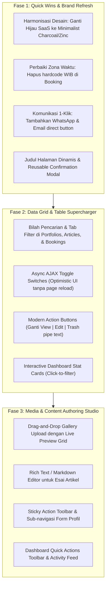

# Comprehensive UI/UX Audit & Experience Upgrade Roadmap
**Target Project:** `dashboard-jef` (Laravel 12 + Blade + Tailwind CSS + Alpine.js)  
**Date:** 15 November 2026  
**Auditor:** Antigravity AI  
**Scope:** Design System, Information Architecture, Data Grid UX, Form & Media Ergonomics, Client Booking Workflow, Micro-interactions & Accessibility

---

## Executive Summary & UX Scorecard

Website portofolio publik Jef (`portfolio-jeff`) telah berhasil ditransformasikan menjadi representasi visual fotografi kelas dunia dengan estetika **Japanese calm minimalism** yang hening, bernafas, dan berwibawa (`#FAF9F6` canvas, charcoal `#18181B` ink, dan tipografi editorial).

Namun, antarmuka administratif internal (`dashboard-jef`) saat ini masih mencerminkan **starter kit SaaS generik**:
1. **Disonansi Visual Brand:** Masih banyak elemen yang menggunakan aksen warna hijau terang (`bg-green-600`, ring hijau, gradient hijau di halaman login) yang kontras tajam dengan jiwa visual minimalis studio fotografi Jef.
2. **Efisiensi Kerja Rendah pada Tabel Data:** Belum ada fitur pencarian (*search*) atau penyaringan (*filter*) di halaman Portfolios, Articles, dan Bookings. Pergantian status publikasi masih memicu *full page reload* (`onchange="this.form.submit()"`).
3. **Pengalaman Manajemen Media & Penulisan Terbatas:** Unggah galeri foto belum memiliki area *drag-and-drop* dan pratinjau thumbnail sebelum submit. Konten esai artikel masih menggunakan `<textarea>` teks polos tanpa toolbar pemformatan (WYSIWYG/Markdown).
4. **Alur Kerja Booking Belum Terintegrasi:** Zona waktu masih tertulis "WIB" (padahal basis operasional Jef adalah Australia), serta belum ada aksi 1-klik untuk menghubungi klien via WhatsApp/Email atau mengekspor sesi ke kalender.

### UI/UX Maturity Scorecard

| Dimensi Evaluasi | Skor Saat Ini (1-10) | Target Upgrade | Catatan Utama |
|---|:---:|:---:|---|
| **Brand Alignment & Aesthetics** | 5.5 / 10 | **9.5 / 10** | Disonansi aksen hijau SaaS vs estetika studio monokromatik |
| **Information Architecture** | 6.5 / 10 | **9.0 / 10** | Dashboard utama belum memiliki Quick Action & Activity Stream |
| **Data Browsing & Table UX** | 5.0 / 10 | **9.5 / 10** | Absennya search/filter; toggle switch memicu refresh halaman |
| **Form & Media Management** | 6.0 / 10 | **9.0 / 10** | Belum ada drag-and-drop galeri; artikel teks polos tanpa editor |
| **Client Relations Workflow** | 5.5 / 10 | **9.0 / 10** | Salah zona waktu; belum ada pintasan WhatsApp/Email langsung |
| **Micro-interactions & Polish** | 6.0 / 10 | **9.5 / 10** | Dialog native browser `confirm()`; belum ada breadcrumb |

---

## 1. Visual Design System & Brand Alignment

### 1.1 Sisa Artefak Aksen Hijau (Green SaaS Gradient & Buttons)
- **Kondisi Saat Ini:**
  - Di [resources/views/layouts/guest.blade.php](file:///d:/Freelance/dashboard-jef/resources/views/layouts/guest.blade.php#L25-L35), halaman login menggunakan latar gradien hijau cerah: `from-green-50 to-green-100 dark:from-gray-900 dark:to-gray-800` dan judul hijau `text-green-700`.
  - Di [resources/views/components/primary-button.blade.php](file:///d:/Freelance/dashboard-jef/resources/views/components/primary-button.blade.php#L10-L16), tombol utama menggunakan `bg-green-600 hover:bg-green-700 focus:ring-green-500`.
  - Hampir semua input form di [admin/portfolios/form.blade.php](file:///d:/Freelance/dashboard-jef/resources/views/admin/portfolios/form.blade.php#L9) dan [admin/articles/form.blade.php](file:///d:/Freelance/dashboard-jef/resources/views/admin/articles/form.blade.php#L6) menggunakan `focus:ring-green-500 focus:border-green-500`.
- **Dampak UX/Visual:** Fotografer merasakan "lompatan visual yang canggung" antara karya seni foto di front-end dan dashboard internalnya. Palet hijau membuat dashboard terasa seperti aplikasi fintech/akuntansi.
- **Rekomendasi Upgrade:**
  - Ubah palet fondasi dashboard menjadi keluarga **Zinc / Neutral Charcoal** (`#18181B`, `#27272A`, `#FAFAFA`).
  - Gunakan tombol utama berwarna hitam/charcoal solid (`bg-zinc-900 hover:bg-zinc-800 text-white dark:bg-zinc-100 dark:text-zinc-900`).
  - Batasi warna hanya untuk status fungsional (*semantic status only*):
    - **Amber/Gold:** Pending Request (`#F59E0B`)
    - **Sky/Slate Blue:** Confirmed Session (`#0284C7`)
    - **Emerald/Teal:** Completed Session / Published (`#10B981`)
    - **Rose/Red:** Canceled / Trashed (`#F43F5E`)
- **Prioritas:** **High**

### 1.2 Hirarki Tipografi & Sentuhan Editorial
- **Kondisi Saat Ini:** Dashboard sepenuhnya mengandalkan sans-serif default [Figtree](file:///d:/Freelance/dashboard-jef/tailwind.config.js#L16). Judul karya foto dan esai ditampilkan dengan teks sans-serif biasa tanpa aksen editorial.
- **Dampak UX:** Tampilan terasa datar (*flat*) dan kurang mengapresiasi judul karya seni fotografi.
- **Rekomendasi Upgrade:**
  - Tambahkan font serif editorial yang selaras dengan front-end (`Cinzel` atau `Playfair Display` atau `Newsreader`) secara terukur untuk judul halaman dan card title utama, dikombinasikan dengan Sans-serif bersih berjarak huruf proporsional (`tracking-tight`).
- **Prioritas:** **Medium**

---

## 2. Dashboard Overview & Executive Control Center

### 2.1 Kartu Statistik yang Statis & Kurang Kontekstual
- **Kondisi Saat Ini:** Di [resources/views/dashboard.blade.php](file:///d:/Freelance/dashboard-jef/resources/views/dashboard.blade.php#L11-L84), 6 kartu metrik hanya berupa kotak putih dengan border kiri berwarna. Kartu tidak memiliki icon grafis, tidak dapat diklik (*not clickable*), dan tidak menampilkan indikator tren atau status terkini.
- **Dampak UX:** Fotografer harus mengarahkan kursor dan mencari menu navigasi atas untuk memeriksa apa saja booking yang pending, alih-alih cukup mengklik kartu "Pending Requests" untuk langsung difilter.
- **Rekomendasi Upgrade:**
  - Jadikan seluruh stat card sebagai elemen interaktif: mengklik kartu *Pending Requests* langsung membuka halaman `/admin/bookings?status=pending`.
  - Berikan icon grafis minimalis di sudut kanan atas tiap kartu (icon kamera, kalender, jam pasir, pena, album).
  - Tampilkan label kontekstual: misalnya pada kartu pending booking tambahkan teks *"Membutuhkan konfirmasi"*.
- **Prioritas:** **High**

### 2.2 Ketiadaan Quick Actions Toolbar
- **Kondisi Saat Ini:** Di bagian atas dashboard belum ada pintasan aksi cepat untuk alur kerja harian fotografer.
- **Dampak UX:** Untuk mengunggah foto baru, fotografer harus membuka menu Portfolio, menunggu halaman termuat, lalu mengklik tombol Create Portfolio.
- **Rekomendasi Upgrade:**
  - Tambahkan panel **Quick Actions Bar** di bawah header dashboard:
    - `+ Upload New Work` (Buka form create portfolio)
    - `+ Write Journal Story` (Buka form create article)
    - `Lihat Kalender Booking`
    - `Pratinjau Web Publik` (Buka tab baru ke portfolio front-end)
- **Prioritas:** **High**

### 2.3 Ketiadaan Activity Stream & Visual Storage Telemetry
- **Kondisi Saat Ini:** Dashboard hanya menampilkan tabel 5 booking terbaru. Tidak ada ringkasan tentang portofolio yang baru saja diunggah atau status draft artikel.
- **Rekomendasi Upgrade:**
  - Buat layout 2-kolom di dashboard:
    - **Kolom Kiri (65%):** Jadwal & Permintaan Sesi Foto Mendatang (Upcoming Bookings).
    - **Kolom Kanan (35%):** Feed Aktivitas Terbaru (Portofolio terakhir diterbitkan, draft esai yang sedang ditulis, dan indikator penggunaan Cloud Storage).
- **Prioritas:** **Medium**

---

## 3. Data Grid & Table UX (Portfolios, Articles, Bookings)

### 3.1 Absennya Fitur Pencarian & Filter Kategori/Status
- **Kondisi Saat Ini:**
  - [admin/portfolios/index.blade.php](file:///d:/Freelance/dashboard-jef/resources/views/admin/portfolios/index.blade.php#L21) tidak memiliki form pencarian judul dan tidak ada filter dropdown/tab kategori (Portrait, Landscape, Editorial, dll.) maupun filter status (All, Published, Draft, Highlight).
  - [admin/articles/index.blade.php](file:///d:/Freelance/dashboard-jef/resources/views/admin/articles/index.blade.php#L21) tidak memiliki pencarian judul artikel.
  - [admin/bookings/index.blade.php](file:///d:/Freelance/dashboard-jef/resources/views/admin/bookings/index.blade.php#L12) tidak memiliki pencarian nama klien/email dan tidak memiliki filter status per permohonan.
- **Dampak UX:** Ketika koleksi foto dan artikel telah mencapai puluhan, admin harus membuka halaman pagination satu per satu untuk mencari konten tertentu.
- **Rekomendasi Upgrade:**
  - Tambahkan toolbar pencarian instan (*live client search* via Alpine.js atau query string terpadu).
  - Tambahkan bar tab filter:
    - Portfolios: `All (24)` | `Published (18)` | `Drafts (6)` | `Highlights (4)` + Dropdown Kategori.
    - Bookings: `All (12)` | `Pending (3)` | `Confirmed (5)` | `Completed (4)` | `Canceled (0)`.
- **Prioritas:** **Critical**

### 3.2 Toggle Switch Menyebabkan Halaman Reload (Synchronous Refresh)
- **Kondisi Saat Ini:** Di [admin/portfolios/index.blade.php](file:///d:/Freelance/dashboard-jef/resources/views/admin/portfolios/index.blade.php#L178-L180), toggle switch menggunakan:
  ```html
  <input type="checkbox" onchange="this.form.submit()" ...>
  ```
- **Dampak UX:** Setiap kali fotografer menggeser toggle "Published" atau "Highlight", browser memuat ulang seluruh halaman dari awal (*full reload*), layar berkedip, posisi scroll melompat ke atas, dan terasa sangat kaku.
- **Rekomendasi Upgrade:**
  - Gunakan Alpine.js + `fetch()` / `axios` untuk melakukan request `PATCH` secara asynchronous (AJAX) di latar belakang.
  - Tampilkan animasi transisi toggle yang mulus seketika (*optimistic UI*), disertai notifikasi toast kecil di pojok kanan bawah ("Status berhasil diperbarui") tanpa me-reload halaman.
- **Prioritas:** **High**

### 3.3 Tautan Aksi Jadul Menggunakan Garis Pipa (`View | Edit | Trash`)
- **Kondisi Saat Ini:** Di kolom Actions tabel desktop ([admin/portfolios/index.blade.php line 212](file:///d:/Freelance/dashboard-jef/resources/views/admin/portfolios/index.blade.php#L212-L235)), aksi disajikan sebagai tautan teks biru, ungu, dan merah yang dipisahkan oleh karakter pipa:
  ```html
  <a href="...">View</a> <span>|</span> <a href="...">Edit</a> <span>|</span> <button>Trash</button>
  ```
- **Dampak UX:** Desain ini menyerupai antarmuka web era 2000-an. Area klik (*target size*) sangat kecil (~12-14px) yang melanggar standar ergonomi Fitts's Law dan menyulitkan pengguna laptop trackpad atau tablet.
- **Rekomendasi Upgrade:**
  - Ganti dengan **Action Button Pill Group** modern yang bersih dengan icon SVG (Mata untuk View, Pena untuk Edit, Tempat Sampah untuk Trash) dengan touch target minimal 36px dan efek hover yang halus.
- **Prioritas:** **Medium**

---

## 4. Form UX & Media Authoring

### 4.1 Pengalaman Unggah Galeri Foto Masih Primitif
- **Kondisi Saat Ini:**
  - Di [admin/portfolios/form.blade.php](file:///d:/Freelance/dashboard-jef/resources/views/admin/portfolios/form.blade.php#L115-L120), unggah galeri menggunakan `<input type="file" multiple>` standar browser.
  - Saat fotografer memilih 10 foto baru, hanya muncul teks kecil: *"10 new photo(s) selected to add"*. Fotografer **tidak dapat melihat preview visual** thumbnail foto apa saja yang baru ia pilih sebelum menekan tombol Submit.
  - Foto galeri yang sudah ada ditampilkan dalam kotak kecil 64x64px tanpa opsi drag-and-drop urutan dan tanpa kemampuan zoom/lightbox preview.
- **Dampak UX:** Sangat rawan salah unggah foto dan tidak memberikan rasa kendali kurasi visual bagi seorang fotografer profesional.
- **Rekomendasi Upgrade:**
  - Buat **Drag & Drop Upload Zone** interaktif dengan visual dropzone yang lapang.
  - Tambahkan **Live Grid Preview** untuk batch foto yang baru dipilih sebelum di-upload, lengkap dengan tombol silang (*remove*) per foto jika ada foto yang batal diunggah.
  - Tambahkan modal klik-untuk-zoom (Lightbox preview) pada koleksi foto yang sudah tersimpan di galeri.
- **Prioritas:** **High**

### 4.2 Pemformatan Artikel Esai Tanpa Editor (Plain Textarea)
- **Kondisi Saat Ini:** Di [admin/articles/form.blade.php line 51](file:///d:/Freelance/dashboard-jef/resources/views/admin/articles/form.blade.php#L51-L57), konten esai ditulis di dalam tag:
  ```html
  <textarea name="content" id="content" rows="10" placeholder="Write your article content here..."></textarea>
  ```
- **Dampak UX:** Jef menulis esai filosofi fotografi dan cerita di balik karya foto. Mengharuskan fotografer mengetik tag HTML mentah seperti `<p>`, `<strong>`, `<blockquote>`, atau `<h3>` di dalam kotak textarea polos sangat melelahkan dan rentan salah ketik format.
- **Rekomendasi Upgrade:**
  - Pasang editor visual minimalis atau Markdown Editor dengan live preview yang bersih (misalnya TipTap, EasyMDE, atau Quill yang disesuaikan dengan tema gelap/terang).
  - Berikan kontrol tipografi yang elegan: Heading 2, Heading 3, Blockquote (kutipan filosofis), Bold, Italic, Bullet points, dan penyisipan gambar inline.
- **Prioritas:** **High**

### 4.3 Navigasi Form Panjang & Ketiadaan Sticky Action Toolbar
- **Kondisi Saat Ini:** Form [admin/photographer_profile/edit.blade.php](file:///d:/Freelance/dashboard-jef/resources/views/admin/photographer_profile/edit.blade.php) memiliki 5 seksi besar membentang sepanjang 328 baris kode. Tombol "Save Profile Changes" terkubur di bagian paling bawah halaman.
- **Dampak UX:** Fotografer yang hanya ingin mengubah nomor telepon atau bio singkat di seksi atas harus melakukan scroll jauh ke bawah untuk menekan tombol simpan.
- **Rekomendasi Upgrade:**
  - Tambahkan **Sticky Action Bar** di bagian atas atau bawah layar yang selalu menampilkan tombol simpan utama, status perubahan (*unsaved changes indicator*), dan tombol kembali.
  - Tambahkan **Sub-navigasi Tab / Anchor Links** samping: `Identity` | `Hero Statements` | `Biography` | `Philosophy Pillars` | `Contact Channels`.
- **Prioritas:** **Medium**

---

## 5. Booking Workflow & Client Relations UX

### 5.1 Ketidakakuratan Zona Waktu ("WIB")
- **Kondisi Saat Ini:** Di [admin/bookings/index.blade.php line 126](file:///d:/Freelance/dashboard-jef/resources/views/admin/bookings/index.blade.php#L126) dan [admin/bookings/edit.blade.php line 49](file:///d:/Freelance/dashboard-jef/resources/views/admin/bookings/edit.blade.php#L49), waktu sesi foto ditampilkan dengan hardcode:
  ```blade
  {{ $booking->booking_date->format('H:i') }} WIB
  ```
- **Dampak UX:** Berdasarkan hasil brand audit resmi, studio Jef berbasis di Australia (AEST / AWST / Sydney / Perth). Menampilkan label "WIB" adalah residu lama yang membingungkan jadwal sesi foto internasional.
- **Rekomendasi Upgrade:**
  - Hapus hardcode "WIB", ganti dengan zona waktu dinamis atau format internasional yang jelas (contoh: `AEST` / `AEDT` atau format jam standar `14:00 (Local Time)`).
- **Prioritas:** **High**

### 5.2 Absennya Aksi Komunikasi Langsung (WhatsApp & Email 1-Click)
- **Kondisi Saat Ini:** Di halaman [admin/bookings/edit.blade.php](file:///d:/Freelance/dashboard-jef/resources/views/admin/bookings/edit.blade.php#L30-L35), nomor telepon klien hanya berupa teks biasa.
- **Dampak UX:** Untuk menghubungi calon klien yang mengajukan booking, Jef harus menyalin nomor telepon secara manual ke ponselnya.
- **Rekomendasi Upgrade:**
  - Tambahkan tombol pintasan langsung:
    - **WhatsApp Direct:** Link otomatis ke `https://wa.me/<cleaned_phone>?text=Hello%20<name>,%20this%20is%20Jef%20regarding%20your%20photography%20session...`
    - **Email Direct:** Link `mailto:` dengan subjek pre-filled.
    - **Add to Calendar:** Tombol generate event Google Calendar / Apple Calendar (.ics) untuk tanggal sesi yang diajukan.
- **Prioritas:** **High**

---

## 6. Ergonomics, Micro-interactions & Accessibility

### 6.1 Dialog Konfirmasi Menggunakan Native Browser `confirm()`
- **Kondisi Saat Ini:** Pada penghapusan ke trash ([admin/portfolios/index.blade.php line 97](file:///d:/Freelance/dashboard-jef/resources/views/admin/portfolios/index.blade.php#L97)), sistem memanggil popup bawaan browser:
  ```html
  onsubmit="return confirm('Move this portfolio to trash?');"
  ```
- **Dampak UX:** Dialog native browser memblokir seluruh thread JavaScript browser, tampilannya sangat kaku, tidak ramah mobile, dan merusak konsistensi visual aplikasi.
- **Rekomendasi Upgrade:**
  - Buat komponen Blade Modal Konfirmasi Reusable berbasis Alpine.js dengan tampilan backdrop blur gelap, ikon peringatan amber/merah, judul yang jelas, tombol batal yang tenang, dan tombol hapus bernuansa tegas.
- **Prioritas:** **Medium**

### 6.2 Judul Halaman Browser Statis
- **Kondisi Saat Ini:** Di [resources/views/layouts/app.blade.php line 9](file:///d:/Freelance/dashboard-jef/resources/views/layouts/app.blade.php#L9), tag judul browser selalu statis: `<title>{{ config('app.name', 'Dashboard Jef') }}</title>`.
- **Dampak UX:** Saat admin membuka banyak tab browser (misal tab Portfolios, Edit Story, dan Bookings), seluruh tab memiliki nama yang persis sama, menyulitkan identifikasi tab.
- **Rekomendasi Upgrade:**
  - Tambahkan slot `@section('title')` atau prop judul dinamis pada layout: `Manage Portfolios | Jef Studio Admin`, `Edit Booking #14 | Jef Studio Admin`, dll.
- **Prioritas:** **Low**

### 6.3 Desain Halaman Kosong (Empty States) yang Terlalu Hambar
- **Kondisi Saat Ini:** Jika tabel belum memiliki data, hanya ditampilkan ikon garis abu-abu kecil dengan teks *"No portfolios found. Get started by creating a new portfolio"*.
- **Rekomendasi Upgrade:**
  - Rancang ilustrasi/ikon kosong yang ramah dengan tombol call-to-action (CTA) langsung di tengah box (*"Create Your First Portfolio Session"*).
- **Prioritas:** **Low**

---

## Rencana Aksi Perbaikan (Implementation Roadmap)



---

## Matriks Prioritas Rekomendasi

| No | Modul / Halaman | Isu UX yang Ditemukan | Dampak Pengguna | Rekomendasi Solusi | Prioritas |
|---|---|---|---|---|:---:|
| 1 | **All Tables** | Ketiadaan Search & Filter (Portfolios, Articles, Bookings) | Sulit menemukan data saat item bertambah | Tambahkan search bar & tab filter status | **Critical** |
| 2 | **Data Tables** | Toggle switches memicu full page reload | Tampilan berkedip, posisi scroll hilang | Refactor ke async AJAX + toast notification | **High** |
| 3 | **Portfolios Form** | Unggah galeri tanpa live preview & dropzone | Rawan salah upload foto, kontrol visual rendah | Buat drag-and-drop zone + preview grid foto baru | **High** |
| 4 | **Articles Form** | Konten artikel ditulis di plain textarea | Menulis esai sangat tidak nyaman dan lambat | Pasang Markdown / Rich Text Editor terintegrasi | **High** |
| 5 | **Bookings Detail** | Waktu tertulis WIB & belum ada direct chat | Zona waktu salah; admin harus copy manual no HP | Koreksi zona waktu & tambah 1-click WhatsApp/Email | **High** |
| 6 | **Design System** | Dominasi warna hijau terang (SaaS template vibe) | Kontras tajam dengan estetika studio Jef | Adopsi zinc/charcoal palette & semantic status colors | **High** |
| 7 | **Dashboard Home** | Stat cards pasif dan belum ada Quick Actions | Alur navigasi harian fotografer berputar-putar | Jadikan card clickable + buat Quick Actions bar | **High** |
| 8 | **All Tables** | Tombol aksi berupa teks pipa `View \| Edit \| Trash` | Area klik kecil (melanggar Fitts's law) | Ubah menjadi Action Button Pill Group berikon | **Medium** |
| 9 | **Forms** | Form panjang (profil) tanpa sticky action bar | Harus scroll jauh ke bawah hanya untuk klik Save | Tambahkan sticky bottom/top bar simpan | **Medium** |
| 10 | **Micro-interactions**| Dialog native browser `confirm()` saat hapus | Memblokir browser, visual tidak konsisten | Buat Accessible Confirmation Modal Alpine.js | **Medium** |
| 11 | **Layout Shell** | Judul tab browser statis di semua halaman | Sulit membedakan banyak tab yang terbuka | Buat dinamis per halaman | **Low** |
| 12 | **Empty States** | Tampilan data kosong terlalu polos tanpa CTA | Pengalaman awal pengguna terasa hampa | Tambahkan ilustrasi kosong & direct CTA button | **Low** |
